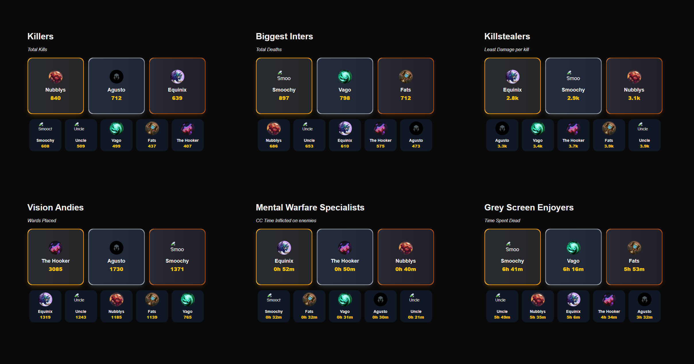

# lolbois-stats

A Next.js stat-tracking site for a group of League of Legends players. It pulls every game the squad has played this season from the Riot Games API, splits them by mode and ranks everyone on per-game stats.



## Categories

Each mode (Summoner's Rift, ARAM: Mayhem) gets its own leaderboards. Per-game stats need `MIN_GAMES` games in that mode to rank. Most categories have a Per game / Total toggle (per game by default).

- **Killers**: kills per game
- **Hey, I Helped**: assists per game
- **Winners**: win rate
- **Marinators**: damage dealt per game
- **Bahamuts**: damage taken per game
- **Biggest Inters**: deaths per game
- **Killstealers**: least damage per kill
- **Grey Screen Enjoyers**: time spent dead per game
- **Mental Warfare**: CC inflicted per game
- **Vision Andies**: vision score per game (Summoner's Rift only)
- **Ping Spammers**: pings per game
- **Penta Machines**: pentakills this season (quadras break ties)
- **First Blood Hunters**: first blood involvement
- **The Anchor**: how much the squad's win rate drops with a player on the team, compared with the same size stack without them (duos win far more than 5-stacks, so sizes are compared separately)
- **Duos**: win rate for every pair of the squad on the same team
- **The Squad**: each player's mains and favourite item

Category definitions live in [`lib/aggregate.js`](lib/aggregate.js) (`SUMS`, every stat summed per player), [`lib/utils.js`](lib/utils.js) (`STAT_DESCRIPTORS`) and [`lib/categories.js`](lib/categories.js).

## Getting Started

```bash
npm install
npm run dev
```

Open [http://localhost:3000](http://localhost:3000) to see the result.

### Environment variables

Create a `.env` with:

```
RIOT_API_KEY=your-riot-api-key
```

Development keys from [developer.riotgames.com](https://developer.riotgames.com) expire every 24 hours. PUUIDs are encrypted per Riot app, so a key from a different app gives everyone new PUUIDs. The script re-resolves them on every run and keeps the old ones as aliases, so the match cache stays valid.

### Data pipeline

The site reads static data from `data/site.json`, generated ahead of time:

```bash
npm run gen-data                 # fetch new matches from Riot, then rebuild data/site.json
npm run gen-data -- --offline    # rebuild data/site.json from the cache only, no Riot calls
```

- `data/players.json` is the roster of Riot IDs.
- Match ids are listed per player and queue since `SEASON_START`, then de-duplicated, so a game several of the squad played together is downloaded once.
- Matches are trimmed and cached in `data/cache/` (gitignored). Later runs only download new games. If a run dies or the key expires, nothing already fetched is lost.
- Requests go through a rate limiter that follows the key's own limits (20/s and 100 per 2 min on a dev key) and backs off on 429s. A first full-season run takes about 15–30 minutes on a dev key.

### Adding players or modes

- **Portraits**: [`data/portraits.json`](data/portraits.json) sets the champion and skins (by name, as in the client) shown for each player. Two skins crossfade. Run `npm run gen-data -- --offline` after editing.
- **Player**: add `{ "gameName": "...", "tagLine": "..." }` to `data/players.json` and run `npm run gen-data`.
- **Mode**: modes with no games this season are hidden automatically. Add an entry to `MODES` in [`lib/modes.js`](lib/modes.js) with its queue ids from [queues.json](https://static.developer.riotgames.com/docs/lol/queues.json). Plain ARAM (queue 450) is there, commented out.
- `SEASON_START`, `MIN_GAMES` and `MIN_DUO_GAMES` live in the same file.

## Tech stack

- [Next.js](https://nextjs.org) (App Router, Turbopack)
- [Tailwind CSS](https://tailwindcss.com) v4
- [Framer Motion](https://www.framer.com/motion/)
- Art and icons from Riot's [Data Dragon](https://developer.riotgames.com/docs/lol#data-dragon)
